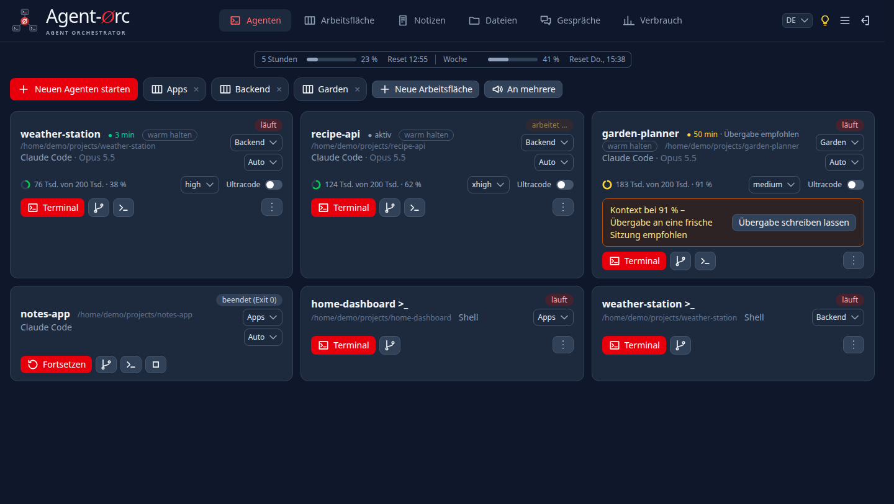
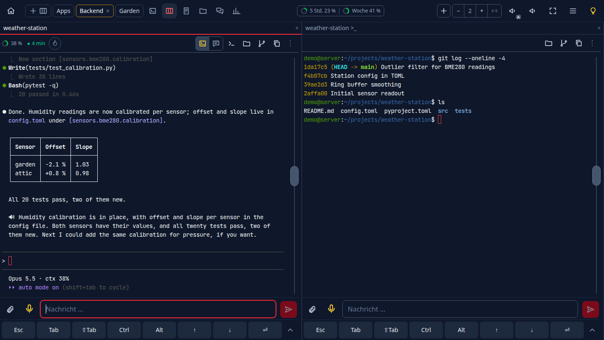
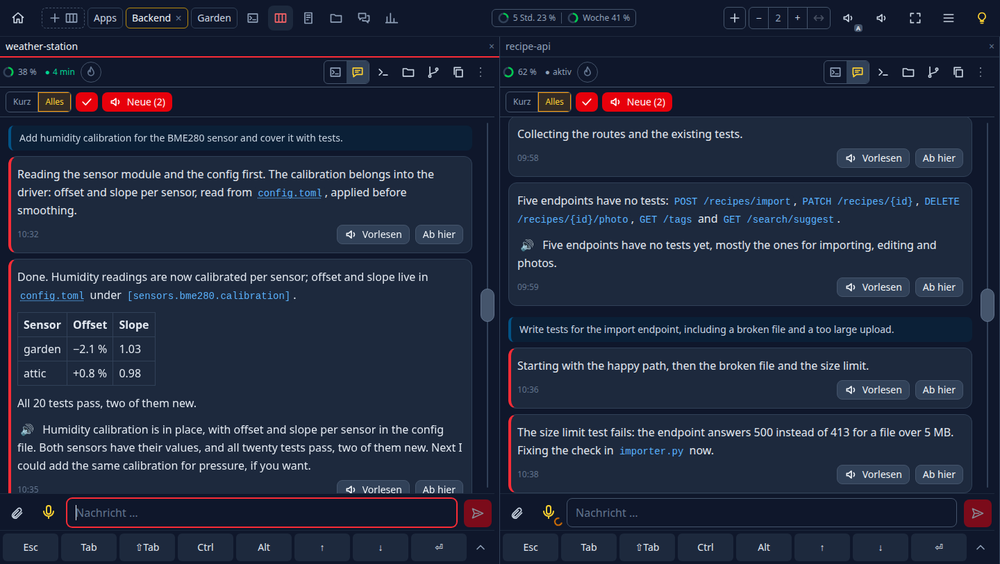
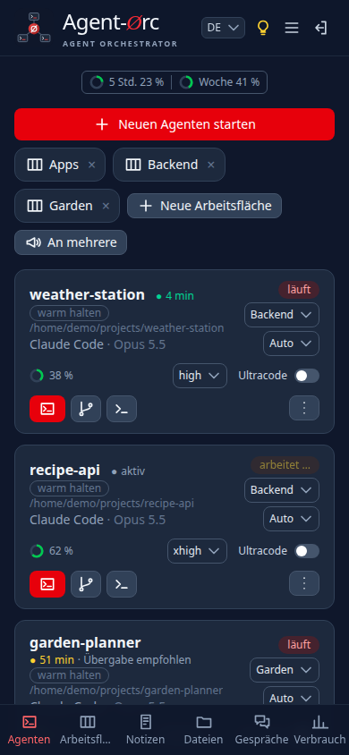
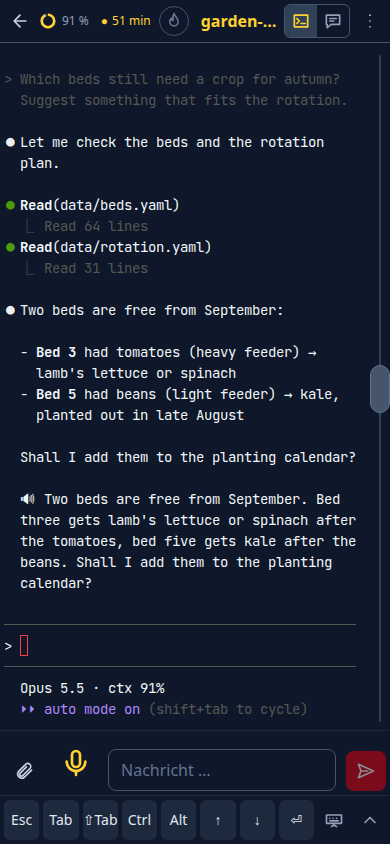

<p align="center">
  <picture>
    <source media="(prefers-color-scheme: dark)" srcset="frontend/brand/logo.svg">
    
  </picture>
</p>

[English](README.md)

> Im täglichen Einsatz, getestet unter Linux mit Claude Code; die Profile für Codex und Aider
> sind vorbereitet, aber ungetestet.

Agent-Orc startet, beobachtet und beendet Coding-Agenten (Claude Code, Codex, Aider, …) auf dem
eigenen Linux-Rechner, bedient über eine Web-App, die am Handy genauso funktioniert wie am
Rechner (PWA).

Jeder Agent läuft in einer eigenen `tmux`-Sitzung in einem Projektordner. Wer den Browser
schließt, trennt nur die Verbindung: Die Agenten arbeiten weiter und lassen sich von jedem Gerät
aus wieder aufnehmen. Weitere Rechner mit Agent-Orc lassen sich in derselben App zeigen, über
einen SSH-Tunnel ([Mehrere Rechner](#mehrere-rechner)).

<p align="center">
  
</p>

## Was es kann

**Agenten**
- Ordner wählen und mit einem Tipp einen Agenten starten; beenden, fortsetzen oder ein
  früheres Claude-Gespräch dieses Ordners wieder aufnehmen.
- Jede Karte zeigt das Modell des Agenten, wie voll sein Kontext ist (Ring: grün, gelb, rot ab
  70 %), ob er gerade arbeitet, und den Denkaufwand als Regler mit Ultracode-Schalter (Claude,
  pro Projektordner).
- Oben das 5-Stunden- und Wochen-Kontingent von Claude; die Karten lassen sich in die eigene
  Reihenfolge ziehen.
- Was ein Agent im Projekt geändert hat: geänderte, neue und gelöschte Dateien mit ihrem Diff
  (git).
- Token-Verbrauch aller Claude-Gespräche pro Tag, Projekt und Modell; Suche in früheren
  Gesprächen; eine Übergabe-Empfehlung, sobald der Kontext eines Agenten groß wird.
- Hält auf Wunsch den Zwischenspeicher ruhender Agenten warm (eine winzige Bitte kurz vor dem
  Ablauf), je Agent einzuschalten, damit die nächste Nachricht ohne Wartezeit kommt. Der Schalter
  übersteht einen Neustart von Agent-Orc und endet mit der Sitzung des Agenten.
- Benachrichtigungen aufs Handy oder den Rechner, wenn ein Agent fertig ist oder auf eine
  Freigabe oder Antwort wartet (Web Push, pro Gerät einschaltbar); Antippen öffnet den Agenten.
- Der Freigabe-Modus, in dem ein Agent startet, pro Projekt (Fragen, Bearbeiten, Auto, Planen;
  Voreinstellung Auto). Fragt ein Agent um Erlaubnis, zeigt seine Karte den Befehl mit
  „Erlauben“ und „Ablehnen“ und dazu die Regeln, die Claude Code statt erneuter Nachfrage
  anbietet („Immer: Bash(git push:*)“, angewandt wie im Terminal); es gilt die Antwort, die
  zuerst kommt, auf der Karte oder im Terminal.
- Backends: `agent-orc backend` startet Claude Code mit lokalen Modellen (z. B. vLLM oder
  llama-swap) oder bei anderen Anbietern (z. B. Qwen bei Alibabas DashScope). Der Startdialog
  bietet dann die Modelle und ihre Denkstufen an, mit einem Hinweis je Modell (etwa wie lange es
  frei nutzbar ist). Siehe „Andere Backends“ unten.
- Ein Agent kann in einem eigenen Git-Worktree starten (zweite Arbeitskopie auf einem neuen
  Branch), damit zwei Agenten an einem Projekt arbeiten können; danach wird er wieder
  entfernt, ohne Arbeit zu verlieren.
- Neu starten (⟳) mit fortgesetztem Gespräch, Prompts für später planen, und nach dem
  Nutzungslimit automatisch weitermachen, sobald das Kontingent zurückgesetzt ist.
- Denselben Prompt an mehrere Agenten auf einmal schicken, abgeschickt oder nur ins Eingabefeld gelegt.
- Jede Karte hat ein Feld für die Arbeitsfläche: Ein Agent kommt in die beim Start gewählte
  Fläche und lässt sich später in eine andere verschieben; ohne Fläche steht er in „Unbenannt“.
  Hat ein Agent noch kein gespeichertes Modell, fragt Agent-Orc beim Neustart und Fortsetzen danach.
- Ein normales Terminal im Projektordner („>_“), auch neben dem laufenden Agenten.

**Arbeitsflächen**
- Mehrere Agenten als Spalten nebeneinander; Spaltenköpfe ziehen sortiert, die Trenner zwischen zwei Spalten
  ziehen verschiebt ihre Grenze (die Breite aller zusammen bleibt; nur auf dem Gerät gespeichert).
- Arbeitsflächen liegen auf dem Server: Jedes Gerät zeigt dasselbe, und eine Änderung erscheint
  sofort überall. „Unbenannt“ steht da, solange es noch keine Fläche gibt, und das „+“ in der Leiste beginnt
  eine neue; mit einem Namen wird sie zu einer benannten, die in der Übersicht und in der Leiste jeder Arbeitsfläche erscheint. Ein Agent
  steht in genau einer Fläche: Fügt man ihn in einer anderen hinzu, wandert er. Ein Klick
  springt in den Tab, der eine Fläche zeigt – praktisch, um Arbeitsflächen auf mehrere Monitore
  zu verteilen. Am Handy wechselt die Leiste im selben Fenster.
- Einen Spaltenkopf auf den Namen einer anderen Fläche in der Leiste fallen lassen verschiebt den
  Agenten dorthin; ein Knopf neben der Spaltenzahl setzt alle verstellten Breiten zurück.
- Tastenkürzel am Rechner: Alt+Umschalt+1 … 9 für die Spalten, Alt+Umschalt+← / → für die
  Arbeitsflächen.
- Am Handy eine Spalte auf einmal: seitlich im Terminal wischen holt die nächste. Die Kopfzeile
  ist für den schmalen Bildschirm gebaut: Der Name der Arbeitsfläche ist ein Knopf mit einem Menü
  dahinter (umbenennen, zu einer anderen Fläche wechseln, eine neue beginnen, löschen), dann „+“
  zum Hinzufügen eines Agenten, die zwei Lautsprecher (Neues vorlesen; automatisch vorlesen),
  Vollbild und der Rechner als kurzer Knopf (an ganzen Buchstaben auf die Breite von „Mini“
  gekürzt; im Menü stehen die vollen Namen). Was man selten braucht, liegt hinter ⋮ (die Hilfe),
  die Einstellungen hinter ☰. Ein Vollbild zeigt nur Terminal und Eingabefeld, die Sondertasten
  lassen sich einklappen, und die Aktionen eines Terminals liegen hinter ⋮.

<p align="center">
  
</p>

**Antworten**

<p align="center">
  
</p>

- Ein Umschalter in jedem Terminal zeigt nur das, was der Agent geantwortet hat (pro Anfrage
  der letzte Text, auf Wunsch jeder), statt des Terminals mit Gedanken und Diffs; was du
  während einer Antwort getippt hast, und seine Bilder erscheinen auch.
- Vorlesen mit den Stimmen des Browsers (eine Antwort, ab hier oder alle neuen; Code und
  Tabellen werden ausgelassen). Die Sprachausgabe ist eine Liste von Engines: mit einem Abschnitt
  `announce:` in der Konfiguration lässt sich der Hörabsatz auch über
  [AIfred](https://github.com/Peuqui/AIfred-Intelligence) auf einem Echo Dot ansagen, im Raum, den
  du in den Einstellungen wählst. Mit einem Abschnitt `tts_suite:` spricht ein
  [TTS-Suite](https://github.com/Peuqui/TTS-Suite)-Dienst auf dem Server: die Engines, die er anbietet (auch auf
  anderen Rechnern und in der Cloud), werden in einem eigenen Fenster der Einstellungen geordnet, angeschaltet
  und mit einer Stimme versehen, und das erste Stück läuft schon, während der Rest noch entsteht; der Browser
  spielt, was der Dienst schickt, und das Token bleibt auf dem Server. Der Vorlese-Knopf „Neue (n)“ wird grau, wenn nichts Neues da ist, wie
  das Häkchen daneben. Das 🔊 vor dem Hörabsatz einer Antwort ist ein Knopf, der ihn noch einmal vorliest; mit der
  TTS-Suite spielt die Wiederholung aus dem Speicher des Browsers (letzte 8 Lesungen, ein Neuladen leert ihn), ohne den
  Dienst erneut zu fragen.
- Jeder Codeblock in den Antworten, in Notizen und in der Markdown-Vorschau hat am rechten Rand
  einen Kopieren-Knopf, über dem Text des Blocks; er bleibt dort stehen, wenn der Block seitlich
  scrollt. Ein Tipp legt den Block in die Zwischenablage, ohne den Zeilenumbruch am Ende (ins
  Terminal eingefügt, würde ein Befehl sonst sofort laufen) – leichter, als am Handy genau die
  richtigen Buchstaben zu markieren. Code im Fließtext (die blauen Wörter) kopiert ein Klick darauf;
  ein Pfad zu einer Datei oder einem Ordner öffnet stattdessen diese.

**Gespräche** (mit [AI-Connect](https://github.com/Peuqui/AI-Connect), der Brücke, über die Agenten-Sitzungen miteinander sprechen; optional)
- Live mitlesen: nach Gespräch (als Chat wie im Messenger: du rechts, von zwei Agenten der, der
  angefangen hat, links, Hinweise der Bridge klein in der Mitte), als Verlauf oder als Spuren
  (Sequenzdiagramm mit einem Pfeil je Nachricht); dazu die Agenten, die online sind, mit ihrem
  Zustand (arbeitet, wartet, bereit).
- Nach Tagen getrennt (Heute, Gestern, Wochentag und Datum), an jeder Nachricht nur die Uhrzeit;
  dieselbe Nachricht mehrmals hintereinander (etwa ein Standby-Hinweis der Bridge) steht einmal da,
  mit Anzahl und Zeitspanne.
- Jeder Agent hat in allen Ansichten seine eigene Farbe (Name, Spur, Pfeil); Hinweise der Bridge
  sind grau, in den Spuren gestrichelt und ganz außen. Die Marken des Handshakes (`[LGTM]`,
  `[CONTINUE]`) stehen als kleine Zeichen neben der Nachricht statt im Text; der eigene Name, den
  viele Agenten ihrer Nachricht voranstellen, fällt weg, er steht ja darüber.
- Ein Klick auf einen Agenten (oben in der Liste, in den Spuren auf seinen Namen) zeigt nur, was ihn
  betrifft: nach Gespräch und im Verlauf als Filter, in den Spuren blendet er den Rest ab; ein
  zweiter Klick zeigt wieder alles.
- Ein zugeklapptes Gespräch zeigt seine letzte Nachricht und die Zahl der ungelesenen (ohne deine
  eigenen und ohne Hinweise der Bridge); gelesen ist, was aufgeklappt war, gemerkt pro Gerät.
- Eingeschaltet durch den Abschnitt `peers:` der Config; AI-Connect hält seine Tokens in eigenen
  Dateien.
- An einen, mehrere oder alle schreiben, als du selbst; Enter sendet, Shift+Enter macht eine neue
  Zeile. In einem aufgeklappten Gespräch antwortet das Feld darunter allen darin.

**Mehrere Rechner**
- Ein weiterer Rechner mit eigenem Agent-Orc (ein zweiter PC, ein WSL unter Windows, ein Server)
  erscheint in derselben App: eine Rechner-Auswahl in der Kopfzeile und seine Agenten unter
  deinen eigenen auf der Übersicht. Seine Terminals, Arbeitsflächen, Notizen und Dateien gehören
  dem Rechner und öffnen sich wie in jeder App.
- Ein Login, eine Adresse: Der andere Rechner hat weder einen Port noch ein Passwort, dein
  SSH-Schlüssel ist der Weg hinein.
- Jeder Rechner liefert seine eigene Web-App: Eine Seite „von“ einem anderen Rechner läuft mit
  dessen Version der Oberfläche. Nach einer Änderung an der Web-App sie auf jeden Rechner
  ausliefern (`deploy/deploy.sh`); ein Handy lädt die neue Version jeder Seite einmal (der Eintrag
  „App neu laden“ am Ende des ☰-Menüs erzwingt es).

**Notizen**
- Notizbücher als Reiter, je mit losen Notizen und Ordnern; sie liegen wie die Arbeitsflächen auf dem Server.
- Eine Notiz ist Markdown mit Formatierungsleiste (fett, kursiv, Überschrift, Liste, Code, Link),
  einer Suche über Titel und Text und Text und Ansicht nebeneinander am Rechner und Tablet.
- Fotos, Screenshots und Dateien an eine Notiz hängen; sie liegen auf dem Server und werden beim
  Senden an einen Agenten in dessen Ordner kopiert. Bilder erscheinen als Vorschau, PDFs mit der
  ersten Seite (auf Wunsch alle, gezeichnet von [pdf.js](https://mozilla.github.io/pdf.js/)).
- Per Diktat (STT-Suite) schreiben, eine Notiz kopieren oder ins Eingabefeld eines oder mehrerer Agenten legen (auf Wunsch abgeschickt).

**Terminal**
- Ein normales Eingabefeld unter dem Terminal, damit Handytastatur, Autokorrektur und Diktat
  funktionieren; Enter sendet, Shift+Enter macht eine neue Zeile.
- Diktat über eine lokale [STT-Suite](https://github.com/Peuqui/STT-Suite) (GPU oder CPU,
  Engine pro Gerät wählbar, z. B. Parakeet oder Whisper) oder die Spracherkennung des Browsers.
- Prompt-Vorlagen für häufige Anweisungen, mit einem Tipp im Eingabefeld.
- Foto, Screenshot (aus der Galerie, am Rechner direkt vom Bildschirm oder einfach mit Strg+V
  eingefügt) oder Datei anhängen: Sie landen im Projektordner, erscheinen als kleine Vorschau
  über dem Eingabefeld und gehen mit der nächsten Nachricht an den Agenten.
- Sondertasten-Leiste (Esc, Tab, Shift+Tab, Pfeile, einrastendes Strg/Alt, …) für die
  Bildschirmtastatur, frei anpassbar und mit Text-Tasten (Makros); eine Textansicht zum
  Markieren und Kopieren, anklickbare Links. Esc im Eingabefeld geht ebenfalls an den Agenten
  (unterbricht ihn), außer es schließt ein Menü des Felds.
- Auf dem Touchscreen fokussiert ein Tipp ins Terminal es (die Sondertasten wirken), ohne die
  Bildschirmtastatur hochzuholen; der Tastaturknopf am Ende der Sondertasten-Leiste holt sie
  herauf und wieder herunter und zeigt, wann sie oben ist. In einem normalen Terminal schreibt
  die Tastatur dann direkt ins Terminal (Verlauf mit den Pfeiltasten, Vervollständigung mit Tab,
  das Diktat der Tastatur); bei einem Agenten öffnet sie das Nachrichtenfeld. Mit Gboard
  gesehen: Schreiben und sein Diktat funktionieren im Terminal, aber ein angetippter
  Wortvorschlag der Vorschlagsleiste schickt „Wort löschen, anderes einfügen“ und zeigt doppelten
  Text; das lässt sich von der Seite aus nicht abschalten.
- Nach einem Diktat scrollt das Nachrichtenfeld ans Ende, damit die neuen Worte zu sehen sind,
  auch wenn der Text länger ist als das Feld.
- Ein Griff am Rand eines Terminals oder der Antworten scrollt schnell, solange er aus der Mitte
  gezogen wird: über die meiste Strecke langsam, am Ende bis zu 200 Zeilen in der Sekunde.
- Zwei Schriftgrößen pro Gerät, in Pixeln, im ☰-Menü (A− und A+): eine für die Terminals, eine
  für die Ansichten (Antworten, Notizen, Gespräche, Dateien, der Editor, Verbrauch, Änderungen),
  deren Texte alle gemeinsam skalieren. Eine Änderung hält den Text, den du liest, an seinem
  Platz, auch wenn größere Buchstaben in mehr Zeilen umbrechen.

**Dateien und mehr**
- Dateien in den Projektordnern durchsuchen, bearbeiten und in den Papierkorb legen (er steht
  neben der Liste: Datei darauf ziehen, dort wiederherstellen oder leeren);
  Markdown als Vorschau, Bilder als Bild, andere Dateien zum Herunterladen.
- Dateipfade in der Ausgabe eines Agenten sind anklickbar und öffnen die Datei (an der
  genannten Zeile) oder den Ordner: im Terminal und in der Antworten-Ansicht bei Pfaden, die als
  Code geschrieben sind (`docs/TODO.md`, `src/app.py:42`). Angeboten werden nur Pfade, die im
  Ordner des Agenten existieren.
- Das ☰-Menü ist eine kurze Liste, jeder Eintrag ein eigenes Fenster direkt unter dem Knopf. Diktat und
  Vorlesen (Engine, Tempo und Tonhöhe als Dezimalfelder, Name des Agenten, Höchstlänge) liegen auf dem Server
  und sind auf jedem Gerät gleich, eine Änderung kommt auf allen offenen an; Terminal-Schrift, die zwei
  Schriftgrößen, Zeilenabstand, Scrollgeschwindigkeit und die Browser-Stimme bleiben am Gerät.
  Eine Hilfe (Glühbirne) erklärt die App.
- Menüs und Auswahlen sehen überall gleich aus: eine Liste, die an dem Knopf aufgeht, der sie
  verlangt hat, am Handy wie am Rechner (nicht die Auswahl des Systems). Sie öffnet nach oben oder
  unten, wo Platz ist (Kopfzeile und Navigationsleiste der App zählen mit), und scrollt, wenn
  keine Seite genug hat.
- Claude-Code-Sitzungen starten mit Remote Control und erscheinen dadurch auch in der Claude-App.
  Beim Beenden und Neustarten eines Agenten wird er zuerst gebeten, sich selbst zu beenden (sein
  `exit_command`, bei Claude `/exit`, dafür gibt `terminal.exit_wait_seconds` Zeit) und erst dann
  wird beendet, was noch läuft: Ein abgeschossenes Claude Code lässt seine Sitzung als Offline-Eintrag
  in der App stehen, den man von Hand archivieren müsste. Ein Ende von außen (der Rechner oder die
  WSL wird ausgeschaltet) lässt sich so nicht abmildern.

<p align="center">
  
  &nbsp;&nbsp;
  
</p>

## Voraussetzungen

- Linux mit `git` und `tmux`
- Python 3.12 oder neuer, mit dem Modul `venv` (Debian/Ubuntu: `apt install python3-venv`)
- Node.js 20.19+ oder 22.12+ mit npm (baut bei der Installation die Web-App; das `nodejs`-Paket
  von Ubuntu ist zu alt, siehe unten)
- die gewünschten Agenten-CLIs, z. B. [Claude Code](https://docs.claude.com/en/docs/claude-code)
- optional, fürs Diktat: [STT-Suite](https://github.com/Peuqui/STT-Suite) (lokale
  Spracherkennung)
- optional, für mehrere Rechner: `ssh` mit Schlüssel-Login auf jeden davon

Die Installation wurde auf frischen Systemen ausprobiert, jeweils wie ein Fremder sie macht:

- **Debian 13** geht mit den eigenen Paketen: `sudo apt-get install -y git tmux python3-venv nodejs npm`
  (Python 3.13, Node.js 20.19).
- **Fedora 43** geht mit den eigenen Paketen: `sudo dnf install -y git tmux python3 nodejs npm`
  (Python 3.14, Node.js 22).
- **Ubuntu 24.04** hat Python 3.12, aber sein Paket `nodejs` ist Node 18 und für den Bau zu alt. Ein
  aktuelles Node.js kommt von NodeSource:

  ```bash
  sudo apt-get install -y git tmux python3-venv curl ca-certificates
  curl -fsSL https://deb.nodesource.com/setup_22.x | sudo -E bash -
  sudo apt-get install -y nodejs
  ```

- **Debian 12 und Ubuntu 22.04** sind zu alt (Python 3.11 / 3.10, Node 18): Der Installer sagt es und
  bricht ab; ein neueres Python muss von anderswo kommen.

`deploy/install.sh` prüft zuerst die Versionen von Node.js und Python und nennt, was fehlt.

## Installation

```bash
git clone https://github.com/Peuqui/Agent-Orc.git && cd Agent-Orc
deploy/install.sh          # baut die Web-App, installiert nach ~/.local/share/agent-orc/venv
agent-orc setup            # stellt ein paar Fragen, schreibt Config und Passwort
agent-orc serve            # http://127.0.0.1:8770
```

`deploy/install.sh` verlinkt den Befehl `agent-orc` nach `~/.local/bin`; dieser Ordner muss im
`PATH` liegen.

Statt zu klonen, geht auch das ZIP des Repositorys (GitHub: Code, Download ZIP):
`unzip Agent-Orc-main.zip && cd Agent-Orc-main && deploy/install.sh`, dann dieselben Schritte.

`agent-orc setup` prüft, ob `tmux` und `git` da sind und welche Agenten-CLIs es findet, und
fragt dann nach:

- dem Ordner mit deinen Projekten (wird angelegt, falls es ihn nicht gibt),
- ob ein anderes Agent-Orc diesen Rechner über SSH steuert (dann lauscht er auf einem Socket und
  verlangt kein Passwort, siehe [Mehrere Rechner](#mehrere-rechner)); wenn nicht, ob er hinter
  HTTPS läuft oder für einen ersten lokalen Test über einfaches HTTP,
- einer STT-Suite fürs Diktat, falls du einen betreibst (es prüft, ob er antwortet); ohne
  ihn nutzt das Mikrofon die Spracherkennung des Browsers (Chrome),
- ob Claude Code mit lokalen Modellen (llama-swap, vLLM) oder mit Qwen bei Alibabas DashScope laufen
  soll (siehe [Andere Backends](#andere-backends)): Adresse des Servers und, bei DashScope, der
  API-Schlüssel, der in eine Datei nur für dich lesbar kommt; die Modelle, die der Server auflistet,
  landen in der Config,
- deiner E-Mail-Adresse für die Push-Dienste, die Benachrichtigungen zustellen (optional),
- dem Passwort für die Web-App.

Es schreibt `~/.config/agent-orc/config.yaml`: die mitgelieferte Standard-Config mit deinen
Antworten; ihre Kommentare erklären alle übrigen Einstellungen. `agent-orc set-password` ändert
das Passwort später.

Danach `http://127.0.0.1:8770` öffnen und mit dem Passwort anmelden.

### Aktualisieren

```bash
git pull && deploy/install.sh
```

Das Skript installiert nur committeten Code und startet einen laufenden Dienst
`agent-orc@<user>` neu; dafür braucht der Benutzer das Recht, ihn neu zu starten (z. B. per
polkit-Regel), sonst den Dienst selbst neu starten. Laufende Agenten überstehen den Neustart.


**Von vor dem 13. Oktober 2026:** Die Einstellung `dictation.whisper_url` in `config.yaml` heißt jetzt `dictation.stt_url` (der Dienst ist die STT-Suite); benenne sie um, sonst wird die Konfiguration abgelehnt.

### Als Dienst

`deploy/agent-orc@.service` betreibt Agent-Orc für einen Benutzer (`agent-orc` muss in dessen
`PATH` liegen):

```bash
sudo cp deploy/agent-orc@.service /etc/systemd/system/
sudo systemctl enable --now agent-orc@$USER
```

### Hinter nginx

`deploy/nginx-location.conf` stellt Agent-Orc unter `/agent-orc/` in einem HTTPS-Serverblock
bereit, samt Terminal-WebSocket. Hinter HTTPS lässt sich die App auf dem Handy-Startbildschirm
installieren.

### Mehrere Rechner

Jeder Rechner betreibt ein eigenes Agent-Orc; das, das du im Browser öffnest (der Hauptrechner),
zeigt die anderen. Auf den anderen wird nichts aus dem Quellcode installiert: Der Hauptrechner
baut die Web-App und liefert sie per SSH aus. Der andere Rechner braucht `python3` (3.12+, mit
`venv`), `tmux`, `git`, die dort gewünschten Agenten-CLIs und einen SSH-Login mit Schlüssel (kein
Passwort).

```bash
# 1. Auf dem Hauptrechner: das Programm zum anderen schicken (ssh-Optionen wie bei ssh).
deploy/deploy.sh -p 2222 ich@anderer-rechner
# 2. Einmal auf dem anderen Rechner: die Frage nach einem anderen Agent-Orc mit „ja“ beantworten.
ssh -t -p 2222 ich@anderer-rechner agent-orc setup
# 3. Nochmal: jetzt findet es eine Config und startet den Dienst (ein systemd-Benutzerdienst).
deploy/deploy.sh -p 2222 ich@anderer-rechner
```

Danach den Rechner in der `~/.config/agent-orc/config.yaml` des Hauptrechners benennen und diesen
neu starten (die Kommentare der Config enthalten dasselbe Beispiel):

```yaml
hosts:
  Anderer:
    ssh: ["-p", "2222", "ich@anderer-rechner"]
    socket: /home/ich/.local/state/agent-orc/run/agent-orc.sock   # server.socket des anderen Rechners
```

Der Rechner erscheint dann in der Rechner-Auswahl der Kopfzeile (sie bleibt auf der Seite, auf der
du bist) und unter deinen Agenten auf der Übersicht. Dahinter hält der Hauptrechner einen
SSH-Tunnel zum Socket des anderen offen, baut ihn nach einem Abbruch neu auf und reicht dessen App
unter `/hosts/<Name>/` durch; dein Login dort ist der einzige. Kontingent und Gespräche kommen
immer vom Hauptrechner (ein Konto, ein AI-Connect).

`deploy/deploy.sh` ist zugleich das Update: nach jeder Änderung erneut ausführen (es liefert nur
committeten Code aus, wie `deploy/install.sh`). Die Agenten dort laufen dabei weiter. Der Dienst
endet mit der Benutzersitzung des Rechners; `loginctl enable-linger` (einmal als root) hält ihn auch
ohne Anmeldung am Laufen. Ein Rechner, der aus ist oder dessen Tunnel steht, erscheint als nicht
erreichbar.

#### Ein WSL unter Windows als anderer Rechner

WSL beendet eine Distribution kurz nach dem letzten offenen WSL-Fenster, und weder der SSH-Tunnel
noch die Dienste darin (Agent-Orc, sshd) zählen als eines: Der Tunnel bricht dann mit
`kex_exchange_identification: Connection reset` ab, während der PC noch auf `ping` antwortet.
Eine Sitzung offen halten, zum Beispiel eine versteckte, die mit Windows startet (`Start-WSL.vbs`
im Autostart-Ordner). Auf den vollen Pfad zu `wsl.exe` kommt es an: Der bloße Name scheiterte mit
„Zugriff verweigert“ (Fehler 800A0046). In VBScript wird ein Anführungszeichen in einer
Zeichenkette doppelt geschrieben:

```vbscript
CreateObject("Wscript.Shell").Run """C:\Program Files\WSL\wsl.exe"" -d Ubuntu-24.04 --exec sleep infinity", 0, False
```

`wsl -l -v` zeigt die Distribution als `Running`, solange sie hält; den Namen verwenden, den es
ausgibt. Die Portweiterleitung von Windows zur WSL-Adresse (`netsh portproxy`) gehört nicht zu
Agent-Orc.

**`systemctl --user` nach einem Start ohne Windows-Anmeldung.** Mit `loginctl enable-linger`
startet der Dienst mit der Distribution, aber dann kann WSLg sein eigenes Verzeichnis über
`/run/user/1000` legen, nachdem systemd seine Sockets dort angelegt hat. Sie sind verdeckt:
`systemctl --user` meldet `Failed to connect to bus`, und der Neustart am Ende von
`deploy/deploy.sh` ebenso (das neue Programm ist installiert, das alte läuft weiter; bei einer
Änderung nur an der Web-App ist das egal, sie wird von der Platte ausgeliefert). Ein einmaliger
Neustart des User-Managers (`systemctl restart user@1000`, als root) legt die Sockets in die
sichtbare Schicht; beide Verzeichnisse liegen dann nebeneinander, und WSLg bleibt.
[`docs/aragon/Start-WSL.vbs`](docs/aragon/Start-WSL.vbs) macht das nach jedem Start (als root über
`wsl.exe -u root`, das kein Passwort braucht): Es wartet bis zu 60 Sekunden auf die Schicht von
WSLg, startet `user@1000` nur neu, wenn der Bus verdeckt ist, und protokolliert in
`/var/log/wsl-user-bus-fix.log`, was es getan hat. Den Namen der Distribution und die Nummer des
Benutzers (1000) anpassen. In VBScript ist `Fix` ein Befehl und kann deshalb nicht als
Variablenname dienen. Ein Doppelklick bei laufender WSL startet ein weiteres `sleep infinity`
(harmlos).

### Tipp: neue Agenten sofort loslegen lassen

Ein Claude-Code-Agent wartet auf die erste Nachricht. Sein Startbefehl in der Config nimmt am
Ende eine erste Anfrage an, etwa um die Schritte auszuführen, die deine Hooks verlangen:

```yaml
agents:
  claude:
    start: [claude, --settings, ..., --remote-control, "{name}",
      "Sitzungsbeginn: Führe die Pflichtschritte aus deinem Startkontext aus und melde dich dann in einem Satz bereit."]
```

Beim Fortsetzen wird sie nicht wiederholt.

## Andere Backends

`agent-orc backend` startet Claude Code bei einem anderen Dienst als dem von Anthropic. Jeder Start
ist ein eigener Prozess, dessen Umgebung allein sagt, mit wem er spricht; Agenten bei Anthropic,
auf einem lokalen Server und in einer Cloud laufen daher nebeneinander. (Ein Server, der große
Modelle ein- und auslagert, etwa llama-swap mit exklusiver Gruppe, hält nur eines: Agenten auf
verschiedenen Modellen davon verdrängen sich.)

```
agent-orc backend models <Backend>             die angebotenen Modelle, eines je Zeile
agent-orc backend levels <Backend> <Modell>    die Denkstufen, die ein Modell annimmt
agent-orc backend run <Backend> [<Modell>] ... Claude Code darauf (weitere Argumente gehen an Claude)
```

Ein Backend steht im Abschnitt `backends` der Config, ein Profil `claude-<Backend>` benutzt es;
`agent-orc setup` schreibt beides, wenn du ein Backend möchtest. Der Server muss Anthropics Messages-API unter
`anthropic_path` anbieten und seine Modelle unter `models_path` auflisten. Angeboten werden nur
die in der Config genannten Modelle; ein Name darf ein Shell-Muster sein. `levels` nennt die
Denkstufen eines Modells (eine gewünschte, die es nicht kennt, wird zur nächsthöheren, die es
kennt); `free_until` blendet ein Modell aus, sobald sein Gratis-Kontingent endet. Der Schlüssel
kommt aus genau einem von `key`, `key_file` (nur für dich lesbar, `chmod 600`) oder `key_env`. Wo
der Server sie meldet (vLLM: `max_model_len`), wird die Kontextlänge an Claude Code übergeben, das
sonst 200k annähme. Hooks der Sitzung finden den Namen des Backends, seine Adresse und das
Modell in `AGENT_ORC_BACKEND`, `AGENT_ORC_BACKEND_URL` und `AGENT_ORC_BACKEND_MODEL`.

Mit `gpu_orc: {port: 5070}` bittet ein Backend [GPU-Orc](https://github.com/Peuqui/GPU-Orc) auf dem
Rechner seiner Modelle, die Grafikkarten für das Modell freizuräumen, bevor es lädt: beim Start und
über den Hook `agent-orc agent-free-cards` bei jeder Eingabe (der Server kann das Modell nach seiner
Leerlaufzeit entladen haben). GPU-Orc läuft neben dem Modellserver, unter der Adresse des Backends
mit eigenem Port; von einem anderen Rechner aus braucht er sein Token (`token_file`), und
`model_server` nennt seinen Modellserver, wenn er mehrere kennt. Was er getan hat, wird angezeigt;
antwortet er nicht oder bleiben Karten belegt, erscheint das als Problem, und Start oder Eingabe
gehen weiter.

```yaml
backends:
  local:
    label: Lokale Modelle
    base_urls: [http://127.0.0.1:11435]
    key_variable: ANTHROPIC_API_KEY
    key: no-key
    models:
      mein-modell: {levels: [low, medium, xhigh]}
  dashscope:
    label: Qwen (DashScope)
    base_urls: [https://dashscope-intl.aliyuncs.com]
    anthropic_path: /apps/anthropic
    models_path: /compatible-mode/v1/models
    key_file: ~/.config/agent-orc/dashscope.key
    models:
      qwen3.8-flash: {levels: [low, medium, xhigh]}
```

Für lokale Modelle eignet sich [llama-swap](https://github.com/mostlygeek/llama-swap): Es stellt
mehrere Modelle hinter einer Adresse bereit, lädt jedes auf Anfrage und bietet Anthropics API an.
[`docs/backends/llama-swap.example.yaml`](docs/backends/llama-swap.example.yaml) ist eine minimale
Konfiguration mit dem passenden `backends`-Eintrag.

## Tests

```bash
~/.venv/devtools/bin/ruff check . && ~/.venv/devtools/bin/mypy && venv/bin/python -m pytest   # Backend, mit echtem tmux
cd frontend && npm test                                               # reine Frontend-Logik (Test-Runner von Node)
```

## Sicherheit

Agent-Orc gibt Zugriff auf den Rechner auf Shell-Ebene. Es bringt einen eigenen Login mit und
lauscht nur auf `127.0.0.1`. Ins Internet nur hinter HTTPS stellen, am besten hinter einem
Reverse Proxy mit zusätzlicher Authentifizierung.

Ein von einem anderen Rechner gesteuerter Rechner hat weder Login noch Port: Er lauscht auf einem
Unix-Socket in einem Ordner, den nur sein Benutzer betreten darf (bei jedem Start geprüft), und
hinein kommt, wer sich mit dem Schlüssel per SSH auf diesem Rechner anmelden darf. Den Schlüssel
genauso sorgfältig verwahren wie den Login.

## Star History


<sub>Täglich erhoben in [Peuqui/Traffic](https://github.com/Peuqui/Traffic), zusammen mit Aufrufen und Klonen. GitHub hat die Stargazer-API am 30.06.2026 auf Repo-Admins beschränkt, deshalb brauchen externe Diagramm-Dienste jetzt ein Token mit Schreibrechten.</sub>

## Lizenz

[PolyForm Noncommercial 1.0.0](LICENSE): Herunterladen und Nutzen für jeden nichtkommerziellen Zweck frei; kommerzielle Nutzung nur mit Erlaubnis des Autors.
