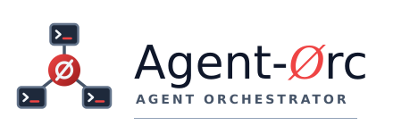
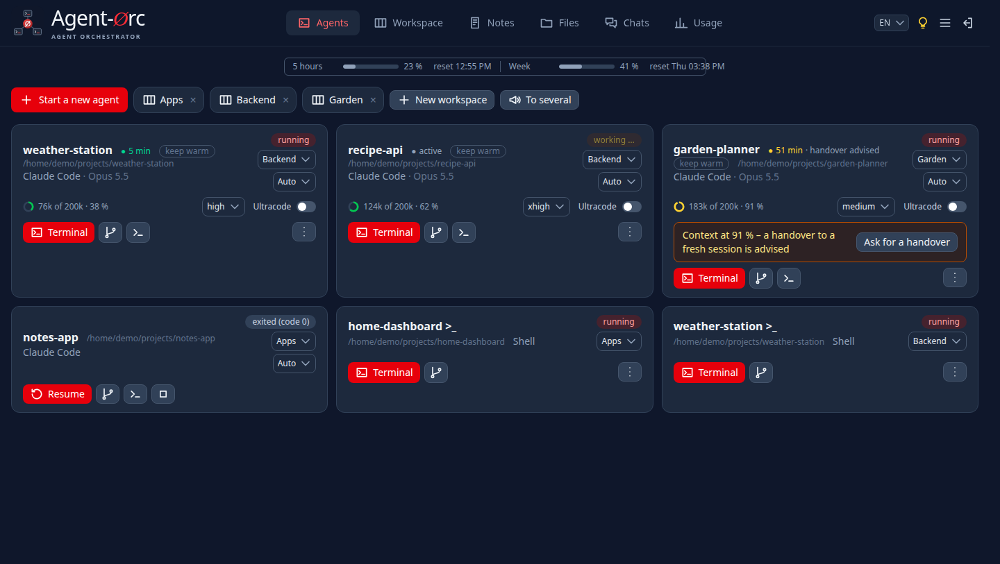
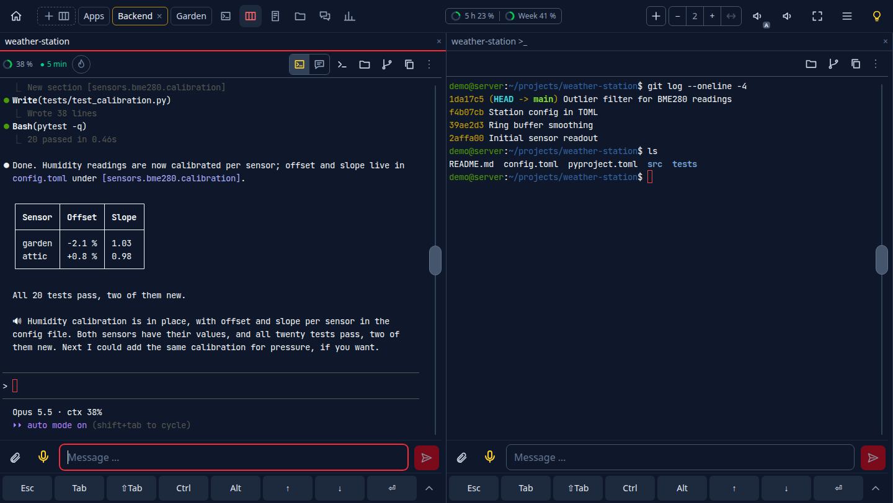
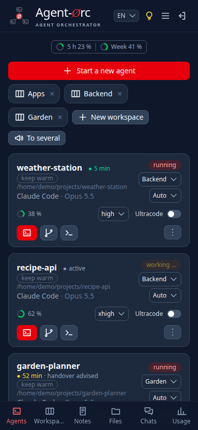
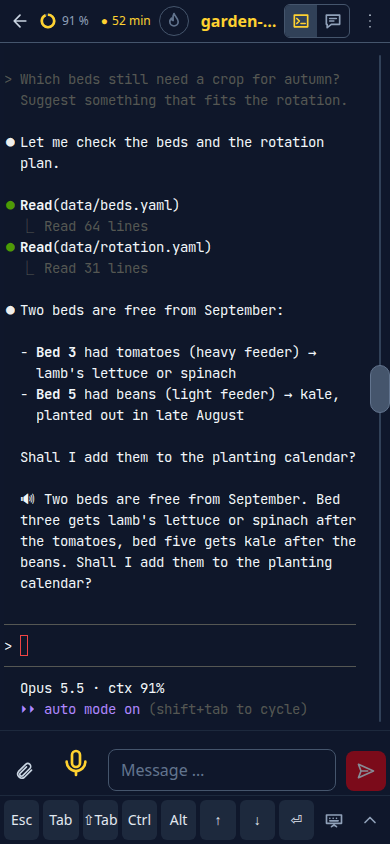

<p align="center">
  <picture>
    <source media="(prefers-color-scheme: dark)" srcset="frontend/brand/logo.svg">
    
  </picture>
</p>

[Deutsch](README.de.md)

> **Status: early, but in daily use.** Tested on Linux with Claude Code; the profiles for
> Codex and Aider are prepared but untested.

Agent-Orc starts, watches and stops coding agents (Claude Code, Codex, Aider, …) on your own
Linux machine, from a web app that works on the phone as well as on the desktop (PWA).

Every agent runs in its own `tmux` session inside a project folder. Closing the browser only
detaches: the agents keep working, and you pick them up again from any device. Other machines
that run Agent-Orc can be shown in the same app, through an SSH tunnel ([Several machines](#several-machines)).

<p align="center">
  
</p>

## What it does

**Agents**
- Pick a folder and start an agent with one tap; stop, resume, or resume an older Claude
  conversation of that folder.
- Every card shows the agent's model, how full its context is (ring: green, amber, red from
  70 %), whether it is working right now, and the reasoning effort as a slider with an
  ultracode switch (Claude, per project folder).
- Claude's 5-hour and weekly usage at the top; cards can be dragged into your own order.
- What an agent changed in its project: changed, new and deleted files with their diffs (git).
- Token consumption of all Claude conversations per day, project and model; search in earlier
  conversations; a handover advice once an agent's context grows large.
- Notifications on your phone or desktop when an agent is done or waits for a permission or an
  answer (Web Push, switched on per device); tapping one opens the agent.
- The permission mode an agent starts in, per project (ask, edit, auto, plan; auto by default).
  When an agent asks for permission, its card shows the command with “Allow” and “Deny”; the
  first answer counts, on the card or in the terminal.
- Backends: `agent-orc backend` runs Claude Code on local models (e.g. vLLM or llama-swap) or
  with other providers (e.g. Qwen on Alibaba's DashScope). The start dialog then offers the
  models and their reasoning levels, with a note per model (such as how long it is free to
  use). See “Other backends” below.
- An agent can start in a git worktree of its own (a second working copy on a new branch), so
  two agents can work on one project; removed again once it has ended, without losing work.
- Restart (⟳) with the conversation resumed, schedule prompts for later, and carry on by
  itself after the usage limit once the quota is reset.
- Send the same prompt to several agents at once, submitted or only put into their input.
- Every card has a workspace field: an agent joins the workspace chosen at start and can be
  moved to another later; one without a workspace stands in “Default”. An agent that has no
  stored model is asked for one when it is restarted or resumed.
- A plain terminal in the project folder (“>_”), also next to the running agent.

**Workspaces**
- Several agents side by side as columns; drag the column heads to sort them and the dividers
  between two columns to move their boundary (the width of all together stays; kept on the device).
- Workspaces live on the server, so every device shows the same and a change appears
  everywhere at once. "Default" stands there while there is no workspace yet, and the "+" in the bar starts a new
  one; give it a name and it becomes a named one, which shows up in the overview and in the bar of every workspace. An
  agent stands in exactly one workspace: adding it to another moves it. One click jumps to the
  tab that shows a workspace – handy for spreading workspaces over several monitors. On the
  phone the bar switches in place.
- Drop a column head on another workspace's name in the bar to move the agent there; a button
  next to the column count resets all widths dragged to another size.
- Shortcuts on a computer: Alt+Shift+1 … 9 for the columns, Alt+Shift+← / → for the
  workspaces.
- On a phone one column at a time: a sideways swipe in the terminal brings the next. The header
  is made for the narrow screen: the workspace's name is a button with a menu behind it (rename
  it, go to another workspace, start a new one, delete it), then “+” to add an agent, the two
  speaker buttons (read aloud what is new; read aloud by itself), full screen, and the machine
  as a short button (cut at whole letters to the width of “Mini”; its menu holds the full
  names). What is needed rarely sits behind ⋮ (the help), the settings behind ☰. A full screen
  shows terminal and input field only, the extra keys fold away, and a terminal's actions sit
  behind ⋮.

<p align="center">
  
</p>

**Answers**
- A switch in every terminal shows only what the agent answered (its last text per request, on
  request every text) instead of the terminal with its thoughts and diffs; what you typed
  during an answer and its pictures are shown too.
- Read them aloud with the voices of the browser (one answer, from here on, or all new ones;
  code and tables are left out). The speech output is a list of engines: with an `announce:`
  section in the config, the paragraph for listening can also be said on an Echo Dot through
  [AIfred](https://github.com/Peuqui/AIfred-Intelligence), in the room chosen in the settings.
  With a `tts_suite:` section, a [TTS-Suite](https://github.com/Peuqui/TTS-Suite) service on the
  server speaks (it picks the engine and the voice from its list, also with a cloud engine, and
  the first piece plays while the rest is still being made); the browser plays what it sends, and
  the token stays on the server. “Read new (n)” turns grey when nothing is new, like the check mark beside it.
- Every code block in the answers, in notes and in the Markdown preview has a copy button at the
  right edge of the block, over its text; it stays there while the block scrolls sideways. One
  tap puts the block into the clipboard, without the line break at its end (pasted into a
  terminal, a command would otherwise run at once), which beats marking exactly the right
  letters on a phone.

**Conversations** (with [AI-Connect](https://github.com/Peuqui/AI-Connect), the bridge that lets agent sessions talk to each other; optional)
- Read along live: by conversation (a tree), as a timeline, or as lanes (a sequence diagram with
  an arrow per message); the agents online with their state (working, waiting, ready).
- Switched on by the `peers:` section of the config; AI-Connect keeps its tokens in its own files.
- Write to one, several or all of them as yourself; Enter sends, Shift+Enter breaks the line. In
  an open conversation the field below answers everyone in it.

**Several machines**
- Another machine with its own Agent-Orc (a second PC, a WSL on Windows, a server) shows up in
  the same app: a machine menu in the header, and its agents below your own on the overview.
  Its terminals, workspaces, notes and files are the machine's own and open as in any app.
- One login, one address: the other machine has neither a port nor a password, and your SSH key
  is the way in.
- Each machine serves its own web app: a page “from” another machine runs with that machine's
  version of the interface. After a change to the web app, ship it to every machine
  (`deploy/deploy.sh`); a phone loads the new version of each page once (the “Reload app”
  entry at the bottom of the ☰ menu forces it).

**Notes**
- Notebooks as tabs, each with loose notes and folders, kept on the server like the workspaces.
- A note is Markdown with a formatting bar (bold, italic, heading, list, code, link), a
  search over titles and text, and text and view side by side on computers and tablets.
- Attach photos, screenshots and files to a note; they are stored on the server and copied into
  an agent's folder when the note is sent to it. Pictures show as thumbnails, PDFs with a preview
  of the first page (all pages on request, drawn by [pdf.js](https://mozilla.github.io/pdf.js/)).
- Dictate into a note (Whisper), copy it, or put it into the input of one or more agents (optionally submitted).

**Terminal**
- A plain input field below the terminal, so phone keyboards, autocorrect and dictation work;
  Enter sends, Shift+Enter starts a new line.
- Dictation through a local Whisper service ([STT-Suite](https://github.com/Peuqui/STT-Suite),
  GPU or CPU, engine chosen per device, e.g. Parakeet or Whisper) or the browser's own speech
  recognition.
- Prompt templates for frequent instructions, one tap into the input field.
- Attach a photo, a screenshot (from the gallery, captured from the screen on the desktop, or
  simply pasted with Ctrl+V) or a file: it lands in the project folder, shows as a small preview
  above the input field and goes to the agent with the next message.
- Extra-keys bar (Esc, Tab, Shift+Tab, arrows, sticky Ctrl/Alt, …) for the on-screen keyboard,
  freely arranged and with text keys (macros); a text view for selecting and copying, clickable
  links.
- On a touch screen a tap into the terminal focuses it (so the extra keys work) without raising
  the on-screen keyboard; the keyboard button at the end of the extra-keys bar raises and lowers
  it, and shows when it is up. In a plain terminal the keyboard then types into the terminal
  itself (history with the arrow keys, completion with Tab, the keyboard's own dictation); with
  an agent it opens the message field. Seen with Gboard: typing and its dictation work in the
  terminal, but tapping a word suggestion of the suggestion strip sends “delete the word, insert
  the other” and shows doubled text; the page cannot switch that off.
- After a dictation the message field scrolls to its end, so the new words are in view even when
  the text is longer than the field.
- A jog grip at the edge of a terminal or of the answers scrolls fast while it is pulled away
  from the middle: slowly over most of the track, up to 200 lines a second at its end.
- Two font sizes per device, in pixels, in the ☰ menu (A− and A+): one for the terminals, one for
  the views (answers, notes, conversations, files, the editor, consumption, changes), whose
  texts all scale together. A change keeps the text you are reading in place, also when larger
  letters wrap into more lines.

**Files and more**
- Browse, edit and trash files in your project folders (the trash sits beside the list: drag a
  file onto it, restore or empty it there); Markdown as a preview, pictures as
  pictures, other files to download.
- File paths in an agent's output are clickable and open the file (at the line named) or the
  folder: in the terminal, and in the answers view for paths written as code (`docs/TODO.md`,
  `src/app.py:42`). Only paths that exist in the agent's folder are offered.
- Settings per device (terminal font, the two font sizes, line spacing, scroll speed, speech) and
  a help dialog (light bulb); the settings menu scrolls when it is longer than the screen, so
  the bottom entries, down to “Reload app”, can always be reached.
- Menus and choices look the same everywhere: a list that opens at the button which asked for it,
  on a phone as on a computer (not the system's picker). It opens above or below, wherever the
  room is (the header and the bottom bar of the app count), and scrolls when neither side has
  enough.
- Claude Code sessions start with Remote Control, so they also show up in the Claude app. Stopping
  or restarting an agent asks it to end by itself first (its `exit_command`, for Claude `/exit`,
  with `terminal.exit_wait_seconds` to do so) and only then kills what still runs: a killed Claude
  Code leaves its session in the app as an offline entry, which you would have to archive by hand.
  An end from outside (the machine or the WSL is switched off) cannot be softened that way.

<p align="center">
  
  &nbsp;&nbsp;
  
</p>

## Requirements

- Linux with `git` and `tmux`
- Python 3.12 or newer, with its `venv` module (Debian/Ubuntu: `apt install python3-venv`)
- Node.js 20.19+ or 22.12+ with npm (builds the web app during installation; Ubuntu's own
  `nodejs` package is too old, see below)
- the agent CLIs you want to use, e.g. [Claude Code](https://docs.claude.com/en/docs/claude-code)
- optional, for dictation: [STT-Suite](https://github.com/Peuqui/STT-Suite) (local speech
  recognition)
- optional, for several machines: `ssh` with key login to each of them

The installation was tried on fresh systems, each as a stranger would do it:

- **Debian 13** works with its own packages: `sudo apt-get install -y git tmux python3-venv nodejs npm`
  (Python 3.13, Node.js 20.19).
- **Fedora 43** works with its own packages: `sudo dnf install -y git tmux python3 nodejs npm`
  (Python 3.14, Node.js 22).
- **Ubuntu 24.04** has Python 3.12, but its `nodejs` package is Node 18, too old for the build. A
  current Node.js comes from NodeSource:

  ```bash
  sudo apt-get install -y git tmux python3-venv curl ca-certificates
  curl -fsSL https://deb.nodesource.com/setup_22.x | sudo -E bash -
  sudo apt-get install -y nodejs
  ```

- **Debian 12 and Ubuntu 22.04** are too old (Python 3.11 / 3.10, Node 18): the installer says so and
  stops; a newer Python has to come from elsewhere.

`deploy/install.sh` checks the Node.js and Python versions first and names what is missing.

## Installation

```bash
git clone https://github.com/Peuqui/Agent-Orc.git && cd Agent-Orc
deploy/install.sh          # builds the web app, installs into ~/.local/share/agent-orc/venv
agent-orc setup            # asks a few questions, writes the config and the password
agent-orc serve            # http://127.0.0.1:8770
```

`deploy/install.sh` links the `agent-orc` command into `~/.local/bin`, which must be on your
`PATH`.

Instead of cloning, the ZIP of the repository does as well (GitHub: Code, Download ZIP):
`unzip Agent-Orc-main.zip && cd Agent-Orc-main && deploy/install.sh`, then the same steps.

`agent-orc setup` checks that `tmux` and `git` are there and which agent CLIs it finds, then
asks for:

- the folder that holds your projects (created if it does not exist),
- whether another Agent-Orc controls this machine through SSH (then it listens on a socket and
  asks for no password, see [Several machines](#several-machines)); if not, whether it runs behind
  HTTPS or on plain HTTP for a first local test,
- a Whisper service for dictation, if you run one (it checks that it answers); without one
  the microphone uses the browser's own speech recognition (Chrome),
- whether to run Claude Code on local models (llama-swap, vLLM) or on Qwen at Alibaba's DashScope
  (see [Other backends](#other-backends)): the server's address and, for DashScope, the API key,
  which goes into a file only you can read; the models the server lists end up in the config,
- your e-mail address for the push services that deliver notifications (optional),
- the password for the web app.

It writes `~/.config/agent-orc/config.yaml`, the shipped default with your answers; its comments
explain every other setting. `agent-orc set-password` changes the password later.

Then open `http://127.0.0.1:8770` and log in with your password.

### Updating

```bash
git pull && deploy/install.sh
```

The script installs only committed code and restarts a running `agent-orc@<user>` service;
for that the user needs the right to restart it (e.g. a polkit rule), otherwise restart it
yourself. Running agents keep running across the restart.

### As a service

`deploy/agent-orc@.service` runs Agent-Orc for one user (`agent-orc` must be on that user's
`PATH`):

```bash
sudo cp deploy/agent-orc@.service /etc/systemd/system/
sudo systemctl enable --now agent-orc@$USER
```

### Behind nginx

`deploy/nginx-location.conf` serves Agent-Orc under `/agent-orc/` inside an HTTPS server block,
including the terminal WebSocket. Behind HTTPS the app can be installed on the phone's home
screen.

### Several machines

Each machine runs an Agent-Orc of its own; the one you open in the browser (the main machine)
shows the others. Nothing is installed from source on the others, the main machine builds the
web app and ships it over SSH. The other machine needs `python3` (3.12+, with `venv`), `tmux`,
`git`, the agent CLIs you want there, and an SSH login with a key (not a password).

```bash
# 1. On the main machine: ship the program to the other one (ssh options as you would give ssh).
deploy/deploy.sh -p 2222 me@other-machine
# 2. Once, on the other machine: answer "yes" to the question about another Agent-Orc.
ssh -t -p 2222 me@other-machine agent-orc setup
# 3. Again: now it finds a config and starts the service (a systemd user service).
deploy/deploy.sh -p 2222 me@other-machine
```

Then name the machine in the main machine's `~/.config/agent-orc/config.yaml` and restart it
(the config comments hold the same example):

```yaml
hosts:
  Other:
    ssh: ["-p", "2222", "me@other-machine"]
    socket: /home/me/.local/state/agent-orc/run/agent-orc.sock   # the other machine's server.socket
```

The machine then appears in the machine menu in the header (it stays on the page you are on)
and below your agents on the overview. Behind it, the main machine keeps an SSH tunnel open to
the other's socket, builds it again when it breaks, and passes the other machine's app on under
`/hosts/<name>/`; your login there is the only one. The usage limits and the conversations tab
always come from the main machine (one account, one AI-Connect).

`deploy/deploy.sh` is also the update: run it again after every change (it ships only committed
code, like `deploy/install.sh`). Agents there keep running across it. The service stops with the
machine's user session; `loginctl enable-linger` (as root, once) keeps it running without a login.
A machine that is off, or whose tunnel is down, shows as unreachable.

#### A WSL on Windows as the other machine

WSL ends a distribution a short while after its last open WSL window is gone, and neither the
SSH tunnel nor the services inside (Agent-Orc, sshd) count as one: the tunnel then breaks with
`kex_exchange_identification: Connection reset` while the PC still answers `ping`. Keep a
session open, for example a hidden one that starts with Windows (`Start-WSL.vbs` in the Startup
folder). The full path to `wsl.exe` matters: the bare name failed with "Permission denied"
(error 800A0046). In VBScript a quote inside a string is written twice:

```vbscript
CreateObject("Wscript.Shell").Run """C:\Program Files\WSL\wsl.exe"" -d Ubuntu-24.04 --exec sleep infinity", 0, False
```

`wsl -l -v` shows the distribution as `Running` while it holds; use the name it prints. The
Windows-side port forwarding to the WSL address (`netsh portproxy`) is not part of Agent-Orc.

**`systemctl --user` after a start without a Windows login.** With `loginctl enable-linger` the
service starts with the distribution, but then WSLg may mount its own directory over
`/run/user/1000` after systemd has put its sockets there. They are hidden: `systemctl --user`
fails with `Failed to connect to bus`, and so does the restart at the end of `deploy/deploy.sh`
(the new program is installed, the old one keeps running; for a change to the web app alone that
does not matter, it is served from disk). Restarting the user manager once (`systemctl restart
user@1000`, as root) puts the sockets into the visible layer; both directories then live side by
side and WSLg stays. [`docs/aragon/Start-WSL.vbs`](docs/aragon/Start-WSL.vbs) does it after every
start (as root through `wsl.exe -u root`, which needs no password): it waits up to 60 seconds for
WSLg's layer, restarts `user@1000` only if the bus is hidden, and logs what it did to
`/var/log/wsl-user-bus-fix.log`. Adapt the distribution's name and the user's number (1000). In
VBScript `Fix` is a command, so it cannot be a variable name. A double click while WSL runs
starts one more `sleep infinity` (harmless).

### Tip: let new agents get going at once

A Claude Code agent waits for your first message. Its start command in the config takes a first
request at the end, e.g. to run the steps your hooks ask for:

```yaml
agents:
  claude:
    start: [claude, --settings, ..., --remote-control, "{name}",
      "Session start: run the mandatory steps from your start context, then say in one sentence that you are ready."]
```

Resuming does not repeat it.

## Other backends

`agent-orc backend` starts Claude Code on a service other than Anthropic's. Every start is a
process of its own whose environment alone says where it talks to, so agents on Anthropic's
service, on a local server and in a cloud run side by side. (A server that swaps big models in
and out, such as llama-swap with an exclusive group, holds only one of them: agents on different
models of it push each other out.)

```
agent-orc backend models <backend>             the models on offer, one per line
agent-orc backend levels <backend> <model>     the reasoning levels a model takes
agent-orc backend run <backend> [<model>] ...  Claude Code on it (more arguments go to Claude)
```

A backend is described in the `backends` section of the config, and a profile `claude-<backend>`
uses it; `agent-orc setup` writes both when you ask for a backend. The server must offer Anthropic's Messages API
below `anthropic_path` and list its models below `models_path`. Only the models named in the
config are offered; a name may be a shell pattern. `levels` lists the reasoning levels a model
takes (a wanted level it lacks becomes the next higher one it has); `free_until` hides a model
once its free quota has ended. The key comes from exactly one of `key`, `key_file` (readable for
you alone, `chmod 600`) or `key_env`. Where the server reports it (vLLM: `max_model_len`), the
context length is handed to Claude Code, which would otherwise assume 200k. Hooks of the session
find the backend's name, its address and the model in `AGENT_ORC_BACKEND`,
`AGENT_ORC_BACKEND_URL` and `AGENT_ORC_BACKEND_MODEL`; a command
`before_start` runs once before the start (`{base_url}` and `{model}` filled in).

```yaml
backends:
  local:
    label: Local models
    base_urls: [http://127.0.0.1:11435]
    key_variable: ANTHROPIC_API_KEY
    key: no-key
    models:
      my-model: {levels: [low, medium, xhigh]}
  dashscope:
    label: Qwen (DashScope)
    base_urls: [https://dashscope-intl.aliyuncs.com]
    anthropic_path: /apps/anthropic
    models_path: /compatible-mode/v1/models
    key_file: ~/.config/agent-orc/dashscope.key
    models:
      qwen3.8-flash: {levels: [low, medium, xhigh]}
```

For local models, [llama-swap](https://github.com/mostlygeek/llama-swap) works: it serves several
models behind one address, loads each on request and offers Anthropic's API.
[`docs/backends/llama-swap.example.yaml`](docs/backends/llama-swap.example.yaml) is a minimal
configuration with the matching `backends` entry.

## Tests

```bash
venv/bin/ruff check . && venv/bin/mypy && venv/bin/python -m pytest   # backend, with a real tmux
cd frontend && npm test                                               # pure frontend logic (Node's test runner)
```

## Security

Agent-Orc gives shell-level access to your machine. It has its own login and listens on
`127.0.0.1` only. Expose it to the internet only behind HTTPS, ideally behind a reverse proxy
with additional authentication.

A machine controlled from another one has no login and no port at all: it listens on a Unix
socket in a folder that only its user may enter (checked at every start), and what gets in is
whoever may log in to that machine over SSH with the key. Keep that key as safe as the login.

## License

[MIT](LICENSE)
